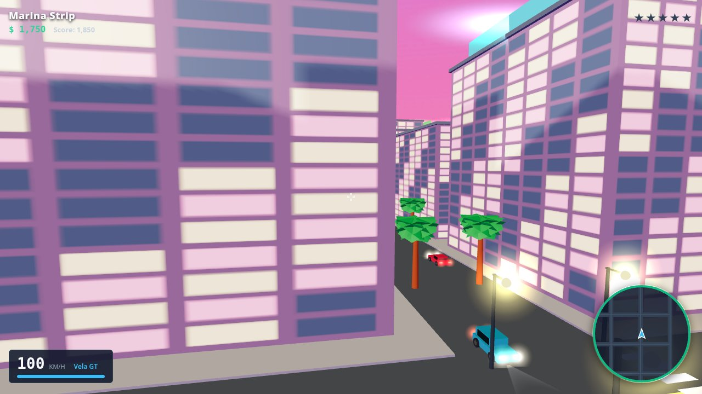
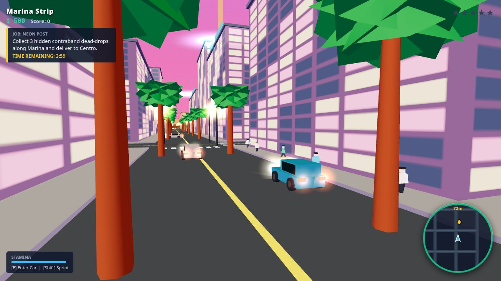
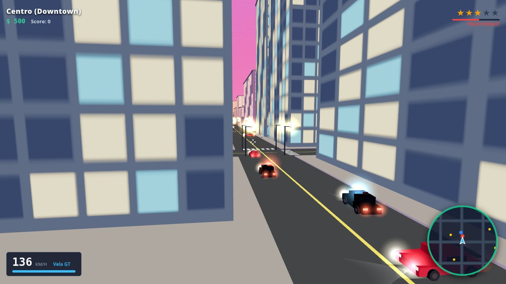
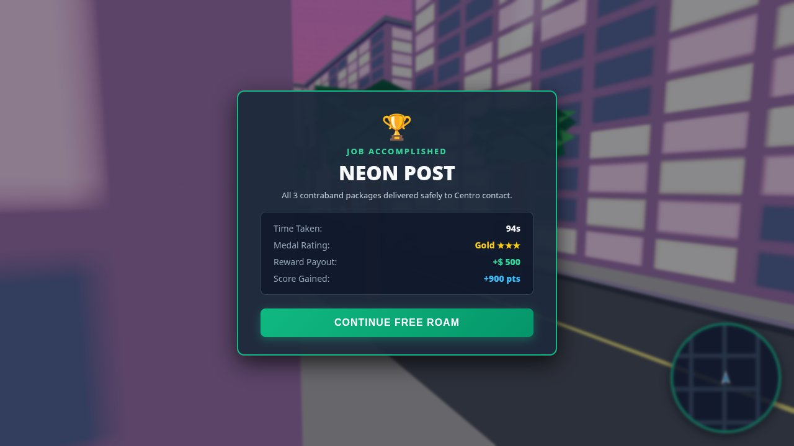

# NEON HARBOR: HEATLINE

> An original 3D open-world crime action game set in the sun-drenched coastal city of Port Solano. Built from scratch for make.fun bounty `gta6-01` ("Make GTA 6").



---

## Overview & Setting

**NEON HARBOR: HEATLINE** is a complete, original open-world crime simulation playable offline in any modern desktop browser with zero external asset dependencies. Set in **Port Solano**—a fictional coastal metropolis in the state of Costa Verde—the game blends 1980s coastal noir with modern arcade gameplay.

Play as **Rafi Sol**, a dockside courier working to settle old debts by taking jobs across the city, evading escalating police pressure, and securing a fortune in cash and contraband.

---

## Key Features

### 1. Fully-Realized 3D Open World (5 Districts)
A deterministic 12 × 10 block road grid (~960 m × 800 m playable area) divided into 5 distinct districts:
- **Old Harbor / Dockside:** Rust-toned container yards, gantry cranes, cargo freighters, and warehouse alleyways.
- **Marina Strip:** Pastel neon beachfront boulevard, swaying palm trees, glowing hotel facades, and sports cars.
- **Centro (Downtown):** Towering modern glass skyscrapers, the 125m Centro Horizon Tower, and CPD Police Headquarters.
- **Barrio Alto:** Elevated hillside switchbacks, warm terracotta stucco, and panoramic city lookouts.
- **Industrial Flats:** Stunt yards, demolition depots, rail sidings, and smoking industrial stacks.

### 2. Vehicle Physics & Traffic AI
- **6 Original Vehicle Classes:**
  - *Sol Hatch:* Nimble compact starter car.
  - *Meridian 4D:* Reliable mid-size civilian sedan.
  - *Vela GT:* High-performance rear-wheel-drive sports coupe.
  - *Barracuda-9:* Heavy-torque muscle car engineered for controlled power slides.
  - *Dockmaster:* Heavy-duty industrial cargo hauler capable of pushing through roadblocks.
  - *CPD Interceptor:* High-speed police pursuit cruiser with active lightbar strobes.
- **Arcade Vehicle Dynamics:** Speed-scaled steering angle, longitudinal acceleration curves, handbrake drift mechanics, and impact impulse damage.
- **Ambient Traffic:** Autonomous vehicles navigating road-network graph nodes with lane-offset tracking, intersection yielding, and collision avoidance.

### 3. Pedestrian & On-Foot Locomotion
- Rafi Sol features smooth third-person locomotion, sprint acceleration, stamina management, and procedural walk-cycle animation.
- Autonomous pedestrians wander sidewalks, flee from high-speed vehicular collisions, and witness crimes.

### 4. 5-Star Wanted System & Police Pursuit AI
- Dynamic heat escalation (0 to 500 heat mapped to 1★ through 5★).
- **1★:** Patrol unit investigates and attempts pull-over.
- **2★:** Multiple cruisers pursue and attempt to box in player.
- **3★:** High-speed pursuit with aggressive PIT maneuvers and roadblocks.
- **4★–5★:** Relentless multi-unit pursuit, interceptor roadblocks, and persistent search radius.
- **Heat Loss Mechanics:** Out-of-sight decay when breaking police line-of-sight and vehicle-swap heat reduction bonus.
- **Busted & Wasted States:** Contact arrest when trapped or immobilized; hospital respawn on critical damage.

### 5. 7 Story Missions
Complete narrative mission arc featuring typed gameplay primitives:
1. **First Run (Tutorial):** High-stakes cargo delivery from Old Harbor to the Marina Strip drop-off.
2. **Neon Post:** On-foot contraband retrieval from 3 dead-drops along the Marina boardwalk, followed by delivery to Centro.
3. **Hot Metal:** Infiltration of a guarded Centro lot, grand theft of the tuned Vela GT prototype, and escaping a 3-star pursuit to the Barrio Alto hideout.
4. **Harbor Heat:** Industrial equipment transport in the Dockmaster through heavy police perimeters to the Shipyard.
5. **Alto Run:** Checkpoint time trial across winding switchbacks (Gold, Silver, Bronze medals).
6. **Flats Demolition:** Timed vehicular demolition of 10 syndicate smuggling crates in the stunt lot.
7. **Heatline (The Grand Finale):** Three-leg relay across all 5 districts under relentless 4-star police pressure.

### 6. Combat & Weapons
- Integrated firearm combat with bullet tracers, raycast hit detection against vehicles and pedestrians, camera recoil impulse, and offense logging.

### 7. HUD & Live Minimap Radar
- **Live Minimap:** Canvas 2D road network radar with player-up rotation, police blips, collectible token pings, and waypoint edge-clamping with distance readout.
- **Contextual HUD:** Digital speedometer, vehicle armor integrity, player health/stamina bars, wanted star badges, and interactive toast notification feed.

### 8. Procedural WebAudio Sound Engine
- 100% synthesized procedural audio using the Web Audio API—zero external audio files:
  - Dynamic vehicle engine hum modulated by RPM and velocity.
  - Dual-tone police sirens with LFO frequency sweeps.
  - Noise-burst gunshots with resonant lowpass decay.
  - Tire skid screeches and physical impact thuds.
  - Built-in multi-voice synthwave background radio.

### 9. Career Results & Economy
- Score attack loop with cash payouts, mission medals, stunt bonuses, 20 hidden collectible Sol Tokens, and a graded Career Dossier (S / A / B / C / D).

---

## Controls

| Action | Primary Key | Secondary Key |
|---|---|---|
| **Steer / Turn / Move** | `W`, `A`, `S`, `D` | Arrow Keys |
| **Accelerate / Drive** | `W` / `Up` | — |
| **Brake / Reverse** | `S` / `Down` | — |
| **Handbrake / Drift** | `Space` | — |
| **Enter / Exit Vehicle** | `E` | — |
| **Sprint (On Foot)** | `Shift` | — |
| **Fire Weapon** | `Space` / `F` | Left Mouse Click |
| **Aim / Look Camera** | Mouse Drag / Move | — |
| **Pause Game** | `P` | `Escape` |

---

## Local Development & Serving

### 1. Launch Game Server
Serve the static game directory locally with Node 22 (no third-party dependencies):
```bash
node serve.ts
```
Open **`http://localhost:8080`** in Google Chrome or any modern Chromium browser.

### 2. Generate Contest Hand-in & Dossier
Compile `/output` and generate the canonical `dossier.json`:
```bash
MAKEFUN_OUTPUT_DIR=out node main.ts
```
The output directory contains:
- `game/`: Static web client (HTML5, ES modules, vendored three.js).
- `screenshots/`: 4 required 1280×720 JPEG captures (≤256 KiB each).
- `dossier.json`: Scorer manifest and source code outline.

### 3. Automated Screenshot Capture
Run the automated screenshot capture suite using headless Chromium:
```bash
node scripts/capture.cjs
```
This captures all 4 scenes specified in `shots.json` (`cover`, `onfoot`, `chase`, `mission`) using the deterministic seed `20261124`.

---

## Technical Architecture & Constraints

- **Fixed-Timestep Simulation:** 60 Hz accumulator pattern (`dt = 1/60`) ensuring identical physics and AI resolution across platforms.
- **Seeded Mulberry32 RNG:** Seeded pseudo-random number generator ensures 100% deterministic city generation and gameplay events.
- **Strict Size Caps:**
  - `game/` files: 23 files total (well below 993-file cap).
  - `game/` size: ~885 KB total (well below 48 MiB cap).
  - Screenshots: 4 JPEGs (55–115 KiB each, well below 256 KiB cap).
  - Dossier text: 163,819 bytes (fits within 163,840-byte cap).
- **Zero External Assets:** All 3D meshes, procedural window textures, road networks, lighting, and audio waveforms are generated in code at runtime.
- **Vendored Three.js:** Three.js r180 minified module build (`three.module.min.js` and `three.core.min.js`) loaded via native HTML import map.

---

## Screenshots

| 1. Cover (Marina Strip Boulevard) | 2. On Foot (Market District Sidewalk) |
|:---:|:---:|
|  |  |
| **3. Police Chase (Centro Pursuit)** | **4. Mission Complete (Job Reward)** |
|  |  |

---

## Credits & License

- **Design, Programming & Direction:** Developed for the make.fun `gta6-01` bounty.
- **3D Engine:** [three.js](https://threejs.org/) (MIT License).
- **License:** [MIT License](LICENSE).
